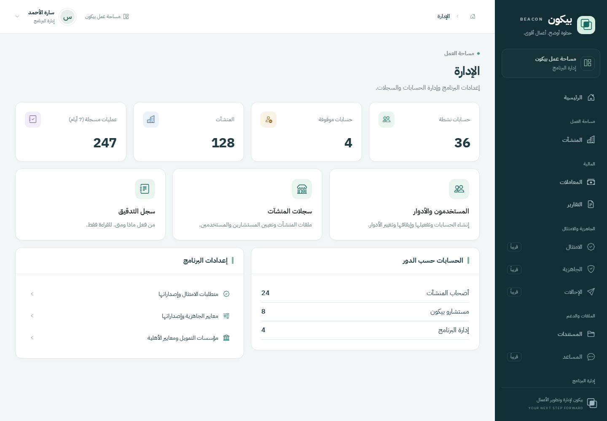
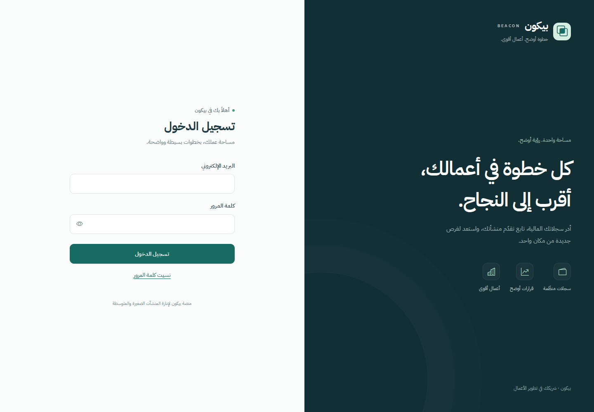
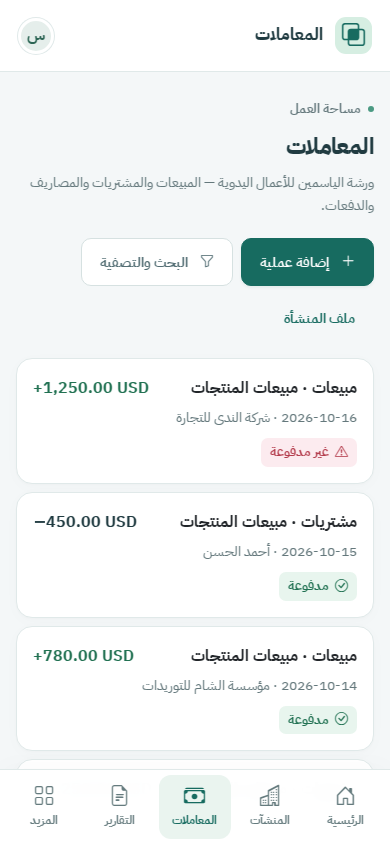

# Beacon interface refresh

The interface uses a single calm visual system across the application: a deep petrol workspace sidebar, green primary actions, pale neutral backgrounds and white content surfaces. Arabic is the default reading direction. Existing server requests, validation, authorizations, calculations and data remain authoritative.

## Visual language

| Token | Value | Purpose |
| --- | --- | --- |
| Primary | `#176B60` | Primary actions and current module |
| Sidebar | `#122F35` | Persistent desktop navigation |
| Background | `#F4F7F8` | Workspace canvas |
| Surface | `#FFFFFF` | Forms, tables and cards |
| Text | `#203B41` | Main content |
| Muted text | `#64787C` | Descriptions and supporting labels |
| Border | `#E0E9E9` | Quiet separation |

`resources/css/app.css` owns the design tokens and Bootstrap overrides. `PageHeader`, `SectionCard`, `StatCard`, `StatusBadge` and `EmptyState` provide the shared structure, including modules whose individual page markup does not need to change.

IBM Plex Sans Arabic is bundled locally as WOFF2 in weights 400–700, with separate Arabic and Latin subsets and `font-display: swap`. Its SIL Open Font License is included with the files. No paid assets, external font requests or additional application dependencies are introduced.

## Layout and interaction

- Below 992 px: compact app header, bottom navigation, safe-area padding and a scrollable More sheet. Existing record cards remain readable on phones.
- From 992 px: a persistent sidebar, breadcrumb header and wider content area support administrative work and tables.
- Navigation uses the existing role and enterprise context. A nested financial page selects its own module rather than also selecting the enterprise directory. Unavailable modules remain visibly unavailable.
- Password fields support reveal/hide, password-manager autocomplete and visible keyboard focus. Amount fields request a decimal keyboard; OTP fields request a numeric keyboard.
- Statuses combine text, icon and color. Empty dashboards retain their unavailable values; the UI does not invent programme or financial metrics.
- The More sheet traps keyboard focus, closes with Escape and on desktop resize, and restores body scrolling. Account menus close on Escape, outside interaction or navigation.
- Offline notices remain below the sticky header. Reduced-motion preferences are respected. Printed reports hide navigation and use the full page width.

## Verification

The frontend was checked with `npx tsc --noEmit`, `npm run build` and `git diff --check`.

Browser review used synthetic Inertia props, with all 40 routable pages covered at 320, 360, 390, 768, 1024 and 1440 px. The original 38 pages passed 228 page/viewport checks without horizontal document overflow or JavaScript exceptions. The two subsequently added MFA screens were checked separately, including pending setup and confirmed/recovery-code states. Representative changed screens were checked again after final adjustments.

Interaction checks covered password visibility, autocomplete, the More sheet's Tab/Shift+Tab/Escape behavior, responsive dismissal, account menus, active navigation, conditional partial-payment fields, LTR rendering, offline notice placement and report printing.

PHP is not installed in the editing environment, so the Laravel test suite and a database-backed end-to-end session were not run. No backend code is changed by this refresh.

## Review images

These images show the implemented React components with synthetic review data; the fixture harness and its data are not shipped in the application.

### Desktop workspace

### Sign in

### Mobile records

